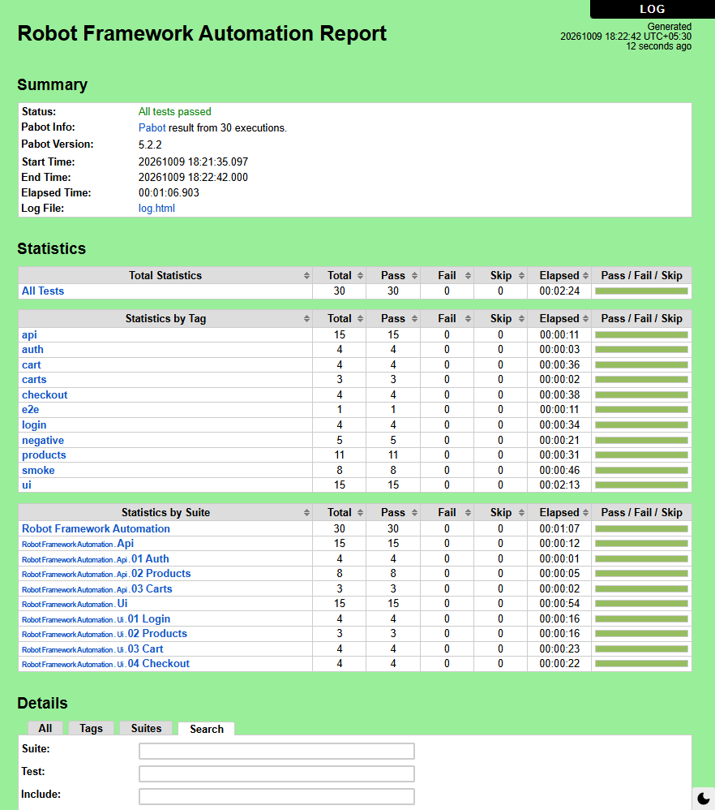
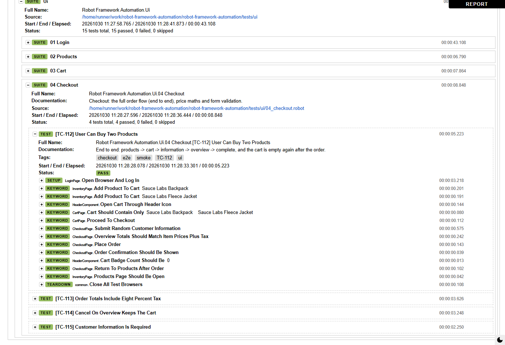
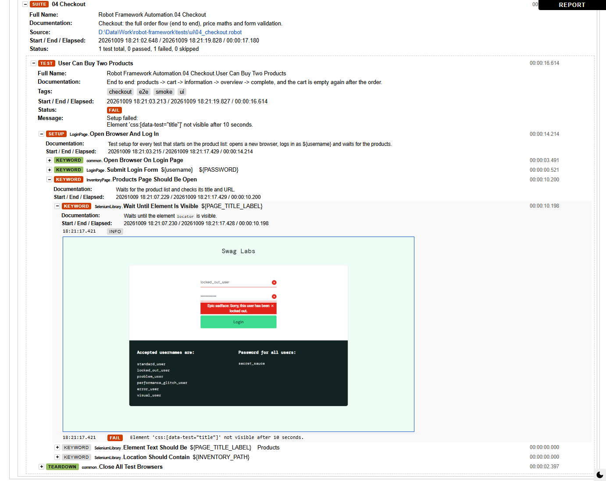

# Robot Framework Test Automation

[](https://github.com/niranjankagri/robot-framework-automation/actions/workflows/ci.yml)

UI and API test automation with **Robot Framework 7**, **SeleniumLibrary** and **RequestsLibrary**,
built on the Page Object Model and run in parallel with **pabot**.

| Layer | Application under test | Library |
|---|---|---|
| UI | [Sauce Demo](https://www.saucedemo.com): login, product list, cart, checkout | SeleniumLibrary 6.9 |
| API | [DummyJSON](https://dummyjson.com): auth, products, carts | RequestsLibrary 0.9 |

**30 tests** (15 UI + 15 API) · full run in about **70 s** with 4 pabot processes · Robocop lint clean.

---

## Contents

- [Setup](#setup)
- [Running the tests](#running-the-tests)
- [Reports](#reports)
- [Project structure](#project-structure)
- [Design: Page Object Model](#design-page-object-model)
- [Configuration](#configuration)
- [Tags](#tags)
- [Writing a new test](#writing-a-new-test)
- [Code quality](#code-quality)
- [Continuous integration](#continuous-integration)
- [Troubleshooting](#troubleshooting)

More background on the design decisions: [docs/framework-design.md](docs/framework-design.md).

## Setup

Needs Python 3.10+ and Chrome (Firefox and Edge work too). SeleniumLibrary uses Selenium Manager,
so no driver download is needed.

```bash
python -m venv .venv

# Activate the venv (pabot needs this: it starts its workers as plain "robot")
.venv\Scripts\activate              # Windows (cmd / PowerShell)
source .venv/Scripts/activate       # Windows (Git Bash)
source .venv/bin/activate           # Linux / macOS

pip install -r requirements.txt
```

## Running the tests

All commands run from the project root with the venv active. Results go to `results/`
(`report.html`, `log.html`, `output.xml`, screenshots of failures).

### Parallel with pabot (recommended)

```bash
# Everything, 4 processes, one test per process slot
pabot --processes 4 --testlevelsplit --artifacts png --artifactsinsubfolders \
      --outputdir results -A args/common.args tests

# Same, headless and with xunit.xml (what a CI server would run)
pabot --processes 4 --testlevelsplit --artifacts png --artifactsinsubfolders \
      --outputdir results -A args/common.args -A args/ci.args tests

# Smoke only (8 tests, ~25 s)
pabot --processes 4 --testlevelsplit --outputdir results -A args/common.args -A args/ci.args -A args/smoke.args tests
```

| pabot option | Why |
|---|---|
| `--processes 4` | number of parallel `robot` processes (default: CPU cores) |
| `--testlevelsplit` | split by test, not by suite: better balance with only 7 suites |
| `--artifacts png --artifactsinsubfolders` | copy the failure screenshots of every process next to the merged log |

### Serial with robot

Same argument files, one process. Handy when debugging a single test with the browser visible:

```bash
robot --outputdir results -A args/common.args tests                       # everything
robot --outputdir results -A args/common.args tests/ui/03_cart.robot      # one suite
robot --outputdir results -A args/common.args --test "User Can Buy Two Products" tests
robot --outputdir results -A args/common.args --include api tests         # by tag
```

### Argument files (`args/`)

Run profiles live in plain-text argument files (one option per line) instead of long command lines.
They combine: later files add to or override earlier ones.

| File | What it sets |
|---|---|
| [`args/common.args`](args/common.args) | report/log titles, tag descriptions; use it every time |
| [`args/ci.args`](args/ci.args) | headless browser, `xunit.xml`, log level INFO |
| [`args/smoke.args`](args/smoke.args) | only tests tagged `smoke` |

## Reports

Every run writes `report.html` (overview) and `log.html` (every keyword step) to `results/`.
With pabot, the per-process outputs are merged into one report, and failure screenshots are
copied next to it (`--artifacts png --artifactsinsubfolders`). In CI they are in the
`results-<browser>` artifact of each run.

**report.html**: totals, then statistics by tag and by suite. This is a full pabot run:
30 tests, about 3 minutes of test time in 1 min 23 s of wall time.



**log.html**: the end-to-end test expanded. Each step is a page-object keyword
(`InventoryPage.Add Product To Cart`, `HeaderComponent.Open Cart Through Header Icon`, `CartPage.Proceed To Checkout`, ...),
so the log reads like the user journey.



**A failure**: SeleniumLibrary takes a screenshot when a keyword fails (`run_on_failure` in
`common.resource`) and embeds it in the log at the failing step. This run was forced to fail by
logging in as the locked-out user (`--variable STANDARD_USER:locked_out_user`).



## Project structure

```
args/                         run profiles (robot/pabot argument files)
.github/workflows/ci.yml      GitHub Actions: lint, then parallel headless run
ci/summary.py                 writes the pass/fail table shown on each CI run page
docs/framework-design.md      why the framework is built this way
docs/images/                  report and log screenshots used in this README
libraries/ShopLibrary.py      custom Python keywords (price parsing, sort check, tax maths, test data)
resources/
  common.resource             browser open/close and options, shared UI helpers
  components/
    HeaderComponent.resource  header on every logged-in page: menu, logout, cart icon + badge
  pages/                      one page object per screen
    LoginPage.resource
    InventoryPage.resource
    CartPage.resource
    CheckoutPage.resource     the three checkout steps (one flow)
  api/                        one service object per endpoint group
    ApiSession.resource       session aliases, open/close, contract check
    AuthApi.resource
    ProductsApi.resource
    CartsApi.resource
tests/
  ui/   01_login  02_products  03_cart  04_checkout      (4 + 3 + 4 + 4 tests)
  api/  01_auth   02_products  03_carts                  (4 + 8 + 3 tests)
variables/config.py           all settings, overridable by env var or --variable
pyproject.toml                Robocop settings
requirements.txt              pinned versions
```

## Design: Page Object Model

```
 tests/*.robot            what is tested (business language, no locators, no HTTP calls)
        |
        v
 pages / components       how a screen is used      api service objects    how an endpoint is called
 (locators live here)                               (URLs, bodies live here)
        |                                                    |
        v                                                    v
 common.resource + ShopLibrary.py                    ApiSession.resource
        |                                                    |
        v                                                    v
   SeleniumLibrary                                     RequestsLibrary
```

Rules the code follows:

1. **Tests never touch a locator, a URL path or an HTTP verb.** They call page / service keywords only,
   so a UI or API change means one edit in one resource file.
2. **One page object per screen**, named after the screen. Each owns its locators, its URL path and
   a `... Should Be Open` check.
3. **Shared screen parts are components** (`HeaderComponent`): they have no URL of their own and
   appear on several pages.
4. **Action keywords do not assert; check keywords say `Should`.** `Submit Login Form` only submits the form,
   so the negative tests reuse it and then call `Login Error Message Should Be`.
5. **The API side mirrors it**: one service object per endpoint group, all sharing one session per suite.
6. **Logic that is awkward in Robot syntax goes to Python** (`ShopLibrary.py`): money with `Decimal`,
   sort checks, random test data.

### Keyword naming

A keyword name says what it does, so a test reads like a script for a manual tester.

| Kind | Pattern | Examples |
|---|---|---|
| Action | verb + object (+ how) | `Submit Login Form`, `Add Product To Cart`, `Open Cart Through Header Icon`, `Proceed To Checkout` |
| Check | subject + `Should ...` | `Products Page Should Be Open`, `Cart Badge Count Should Be`, `Login Error Message Should Be` |
| Getter | `Get ...` (returns a value) | `Get Displayed Product Prices`, `Get Access Token`, `Get Product By Id` |
| Navigation by URL | `Open ... Directly` | `Open Products Page Directly`, `Open Checkout Information Page Directly` |
| Template (data-driven) | `... Should Fail With Error` / `... Should ...` | `Login Should Fail With Error`, `Selected Sort Option Should Order Products` |

Locator variables are named after the element and its type: `${USERNAME_INPUT}`, `${LOGIN_BUTTON}`,
`${CART_ICON_LINK}`, `${PRODUCT_PRICE_LABELS}` (plural when the locator matches several elements).

Keyword documentation for any resource can be generated with Libdoc, e.g.:

```bash
python -m robot.libdoc resources/pages/CheckoutPage.resource results/CheckoutPage.html
```

## Configuration

Every setting is in [`variables/config.py`](variables/config.py) and can be changed without editing code,
either as an environment variable or with `--variable` (the command line wins):

```bash
robot --outputdir results -A args/common.args --variable BROWSER:firefox --variable HEADLESS:True tests/ui
BROWSER=edge pabot --processes 2 --outputdir results -A args/common.args tests/ui      # Git Bash / Linux
```

| Variable | Default | Meaning |
|---|---|---|
| `BROWSER` | `chrome` | `chrome`, `firefox` or `edge` |
| `HEADLESS` | `False` | run without a browser window |
| `TIMEOUT` | `10 s` | maximum wait for any element or condition |
| `UI_URL` | `https://www.saucedemo.com` | shop under test |
| `API_URL` | `https://dummyjson.com` | API under test |
| `API_USER` / `API_PASSWORD` | `emilys` / `emilyspass` | DummyJSON demo user |
| `SAUCE_PASSWORD` | `secret_sauce` | Sauce Demo demo password (public, printed on its login page) |

## Tags

| Tag | Meaning |
|---|---|
| `ui`, `api` | layer (set for the whole suite with `Test Tags`) |
| `login`, `products`, `cart`, `checkout`, `auth`, `carts` | feature area |
| `smoke` | fast checks of the main flows (8 tests) |
| `negative` | wrong input must be rejected |
| `e2e` | a whole user journey |

Select with `--include` / `--exclude`, e.g. `--include smoke`, `--include uiANDnegative`, `--exclude e2e`.

## Writing a new test

1. Find the page object (or service object) for the screen/endpoint. If a keyword is missing, add it
   there with a `[Documentation]`, using the locators in that file's `*** Variables ***`.
2. Write the test in the matching `tests/` suite using only those keywords. Give it a one-line
   `[Documentation]` saying what it proves, and tag it with its area plus `smoke` / `negative` / `e2e`
   where it fits.
3. Keep the test independent: UI tests get a fresh browser from `Test Setup`; never rely on what
   another test left behind (pabot may run them in any order and at the same time).
4. Run `robocop check`, then the suite.

## Code quality

```bash
robocop check          # lint every .robot / .resource file (settings in pyproject.toml)
robot --dryrun tests   # check syntax and that every keyword exists, without running anything
```

Robocop's documentation rules are on, so every suite, test and keyword must have a
`[Documentation]` (it is what `log.html` and Libdoc show). Comments (`#`) explain *why*
something is done where the code alone does not say it.

## Continuous integration

[`.github/workflows/ci.yml`](.github/workflows/ci.yml) runs on every push and pull request to `main`,
by hand (Actions tab → *Run workflow*) and every night at 03:00 UTC. The nightly run matters because
both applications under test are public sites that can change without a commit here.

```
lint  ──►  tests (matrix: chrome, firefox; run in parallel)
 │           │
 │           ├─ pabot --processes 4 --testlevelsplit --outputdir results -A args/common.args -A args/ci.args tests
 │           ├─ job summary: pass/fail per suite + failed tests (ci/summary.py)
 │           └─ artifact results-<browser>: log.html, report.html, output.xml, xunit.xml, screenshots
 │
 └─ robocop check  +  robot --dryrun   (fails in seconds on a typo or broken import)
```

- **Lint gate first**: no browser starts if the code does not even parse.
- **Same argument files as locally**, so a CI failure can be reproduced with the same command.
- **Results are uploaded even when tests fail** (kept 14 days); open `log.html` from the artifact.
- No virtual environment in CI: `actions/setup-python` puts Python and `robot` on `PATH`,
  which is what pabot's workers need.

## Troubleshooting

| Symptom | Cause / fix |
|---|---|
| pabot: "output files are incomplete", worker logs all say `Output: results\output.xml` | an `--outputdir` inside an argument file overrides pabot's per-worker folders; keep `--outputdir` on the command line only |
| pabot: `0 tests` and `FileNotFoundError: [WinError 2]` | the venv is not active; pabot starts its workers as `robot`, which must be on `PATH` |
| Every keyword "not found" after an edit | a `Library` line uses a variable before `Variables ../variables/config.py` is imported; keep `Variables` first |
| A variable silently has the wrong value | Robot ignores case and underscores in names: `${FIRST_NAME}` and `${first_name}` are the same variable |
| API "no token" test passes when it should fail | DummyJSON sets an `accessToken` cookie on login; use `Get Current User Without Token` (fresh session) |
| Chrome "change your password" popup over the page | switched off in `Build Options For Selected Browser`; keep those prefs if you change the options |
